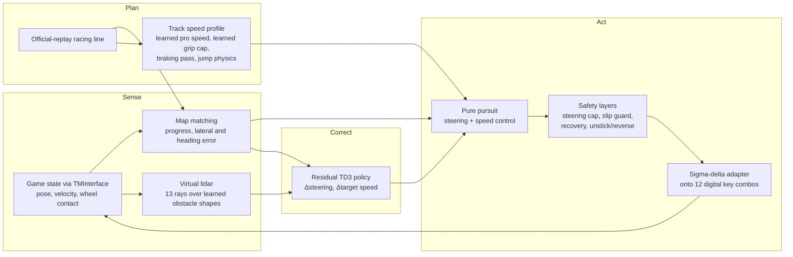

# Linesight hybrid: a robotics stack for TrackMania, and an honest test of residual RL

A classical robotics stack generalised where end-to-end deep RL didn't. The project started as a deep RL agent that
learned one track from pixels and failed on others. The working system is a classical stack (map matching, a speed
profile, pure pursuit, safety layers) whose hand-set numbers are replaced by learned models. A residual RL policy
(TD3) adds bounded corrections on top. On held-out maps, the residual mostly reshuffles which maps finish.

- **The stack generalises.** It finished 27 of 63 Nations campaign maps, one run each, after being developed on 5 of
  them. The end-to-end IQN agent finished 0 of 50 runs on five other maps (8 of 50 at its last checkpoint, all on A03).
- **On 10 held-out maps**, driven 10 times each with seeded steering noise, the stack finishes 25 of 100 runs.
- **Residual RL is a null result.** td3_v3 finishes 27 of 100 (paired sign test p = 0.82; with the map as the unit,
  p = 1.0). It fixes B07 (9/10 vs 2/10) and breaks C02 (1/10 vs 8/10); the other eight maps don't change.
- **The evaluation is the strongest part.** A fixed map split, paired seeded runs, a selection rule fixed before any
  dev result, and a reanalysis of what this design can and can't detect ([review/stats.md](review/stats.md)).

**Read the numbers with these limits:**
- The test set was looked at seven times (v4, v5, v6, v7, v8_rl, a robustness re-run of v7 and v8_rl, and v9_rl).
  After v6, the failure logs of two test maps prompted the gravity measurement, a mild form of test-set leakage.
- Ten maps can't show a small residual effect. Three maps carry every discordant pair, and the design detects a
  gain only if it is about +17 to +20 points of finish rate. More runs per map wouldn't change that.
- The 27/63 campaign result is a single run per map, and the stack had been developed on 5 of those maps.
- There is no collision telemetry. Contacts are inferred from speed drops (over 4 m/s in 50 ms).
- The car is slow: finished maps take about 1.4–1.6× the pro's time.

**[See the project website](https://stormy-1.github.io/linesight-trackmania-rl/)**: the story with videos of the runs,
a 3D replay, and ghost replays of held-out runs drawn from the logs. Every claim in this repo is checked against its
source file in [review/claims.md](review/claims.md).

Built on [Linesight](https://github.com/Linesight-RL/linesight), an open-source RL framework for
TrackMania Nations Forever (see [ATTRIBUTION.md](ATTRIBUTION.md)).

## The arc

1. **Deep RL from pixels (era 1).** An IQN agent learned Hockolicious from screen pixels and telemetry
   (about 54 s). It didn't generalise, and fine-tuning it on several maps made it collapse.
2. **Robotics for generalisation.** A classical stack (map matching, speed profile, pure pursuit, recovery)
   finished 27 of 63 campaign maps, one run each, after being developed on only 5 of them.
3. **Learned models instead of hand-set numbers.** These are a speed model from pro replays, a grip limit from our
   own driving logs, gravity measured from ghost free fall, and obstacle shapes learned from pro ghosts.
4. **Residual RL on top (era 2).** A TD3 policy adds bounded steering and target-speed corrections to the stack's
   command. It starts at exactly zero, so it can only learn from the stack's behaviour, never from scratch. Three
   training generations (td3_v1–v3) addressed a stuck actor, weak exploration and narrow training data. The held-out
   result is a null: it trades B07 for C02.
5. **Paired evaluation.** Each map was driven 10 times with seeded noise and the versions were compared in pairs.
   This showed that the single-run RL gain (4/10 vs 2/10) was luck. It is too small a design to show whether a
   residual effect of a few points is real.

## Deep reinforcement learning in this project

### Era 1: end-to-end deep RL (IQN, from pixels)

- **Agent.** The [Linesight](https://github.com/Linesight-RL/linesight) agent is an Implicit Quantile Network, a
  distributional deep Q-learning method. It takes downscaled game frames plus telemetry and chooses among 12 discrete
  key combinations.
- **This project's work on it:** CPU/GPU-portable training, self-healing game restarts, reward shaping and a
  learning-rate schedule. The result was a 10.6M-frame training run on Hockolicious (details in [ATTRIBUTION.md](ATTRIBUTION.md)).
- **Result.** On Hockolicious it finished 5 of 10 greedy evaluation runs, best 54.06 s. On five other campaign maps
  the 3.18M-frame checkpoint finished 0 of 50 runs. The 10.6M-frame checkpoint finished 8, all of them on A03
  (`eval_results/benchmark_20261014_190540.csv`).
- **Multi-map fine-tuning failed.** Training the pretrained agent on six maps at once made the training loss fall
  while the driving collapsed on every map, Hockolicious included. The new replay buffer was dominated by failed
  runs, which overwrote what the agent knew.
- **Lesson.** End-to-end RL can learn one track superbly but needs far more data to generalise. That motivated
  giving the driving to a robotics stack and using RL only where it adds something.

### Era 2: residual RL on top of the robotics stack

The stack drives, and a small TD3 policy adds Δsteering (±0.25) and Δtarget speed (±8 m/s) at each 50 ms step:
- **Observation (39-D):** the track-relative state, the base command, lookahead geometry, 13 virtual-lidar rays and
  wheel contact.
- **Reward:** progress, minus penalties for impacts, recovery and getting stuck.
- **Shield:** the policy is switched off while a safety layer owns the car.

The design choices that made it train:

| Problem | What was done | Evidence |
|---|---|---|
| An untrained policy would wreck the car | Zero-initialised actor output: training starts exactly at the base stack (760/760 steps identical live) | `trackmania_rl/residual_td3.py`, tests |
| A random critic misleads the first updates | Critic burn-in on the base stack's runs: Q vs true return r 0.89–1.00 | `eval_results/residual_rl/critic_burnin_v2.json` |
| td3_v1's actor never moved (\|a\| ≈ 0.02) | Analysed: the TD3+BC anchor outweighed the critic's gradient. Anchor weakened 10× | `eval_results/residual_rl/td3_v1_offline_anchor_*.json` |
| White exploration noise averages out through the key adapter | Held noise: one draw per 0.5 s | `eval_results/residual_rl/td3_v2/train_log.jsonl` |
| td3_v2 saw only 6 maps and noise-free physics | td3_v3: 20 training maps (6 + 14 drawn by a fixed rule, never dev or test), seeded steering noise during training, 200 episodes | `eval_results/residual_rl/td3_v3/train_config.json` |

**What it did** (the final policy is td3_v3):
- **Held-out test maps (10 runs per map, paired): no significant gain.**
  - Runs finished: 27/100 against the base's 25/100 (exact sign test p = 0.82; map-level sign-flip test p = 1.0).
  - It fixes B07 (9/10 vs 2/10) and breaks C02 (1/10 vs 8/10), 7 pairs to 0 each way (p = 0.016 each uncorrected,
    about 0.16 after correcting for 10 maps). The other eight maps don't change.
  - Mean completion 54.7% against 48.0% (95% interval of the change −1.5 to +20.0 points, so it includes zero),
    23% fewer recovery steps, and 32 wall hits against 41.
- **Dev maps it never trained on:** 60/70 runs finished against the base's 59/70 (p = 1) and mean completion 97.4%
  against 95.0%, but wall hits rose from 6 to 20 and recovery steps from 1,395 to 1,704.
- **Training maps:** td3_v2 already finished C05, where the base stack stalls at 9%. td3_v3 finished it in all of its
  last 6 training episodes.
- **Behaviour** (`scripts/analyze_residual_policy.py`, 11,608 dev and training states): it learned to steer against
  the heading error, on 11 of 13 maps (pooled r −0.22, a weak relation; td3_v2: −0.13, 8 of 13). Its corrections are
  small (mean |a| 0.13) and almost never saturate. The more consistent behaviour coincided with training on more maps
  with noise, but td3_v3 also had more episodes and started from td3_v2, so the cause isn't isolated
  (`eval_results/residual_rl/td3_v3_behaviour.json`).

## Results

The held-out test set is 10 campaign maps across four difficulty tiers. Every map gets identical arguments.

**Robustness evaluation (the definitive numbers).** Each map was driven 10 times, with small seeded noise on the
steering (σ 0.05). Run k gets the same noise in both versions, so the runs can be compared in pairs:

| Version | Runs finished | Maps finished at least once | Mean completion | Wall hits | Recovery steps |
|---|---|---|---|---|---|
| v7: robotics stack + learned models | 25/100 | 4/10 | 48.0% | 41 | 6,543 |
| v8_rl: + residual TD3 (td3_v2, 6 training maps) | 26/100 | 4/10 | 52.8% | 39 | 6,516 |
| **v9_rl: + residual TD3 (td3_v3, 20 training maps, noise)** | **27/100** | 4/10 | **54.7%** | **32** | **5,043** |

- **Pairs, v9_rl vs v7:** 16 runs finished in both, 9 only without RL, 11 only with RL, and 64 in neither
  (exact sign test p = 0.82).
- **With the map as the unit:** only A09, B07 and C02 have any discordant pair. A sign-flip test over maps gives
  p = 1.0, and the cluster-bootstrap interval for the finish-rate change is −19 to +23 points
  (`scripts/reanalyze_clustered.py`, [review/stats.md](review/stats.md)).
- **Per map:** RL is better on B07 (td3_v2 8/10, td3_v3 9/10, base 2/10) and worse on C02 (3/10 and 1/10 vs 8/10),
  p = 0.016 each, about 0.16 after correcting for 10 maps. The two policies agree, but td3_v3 was initialised from
  td3_v2 and trained on a buffer holding its episodes, so this is consistency within one policy lineage, not an
  independent replication.
- **Completion and recovery:** td3_v3 changes mean completion by +6.7 points (bootstrap over maps, 95% interval
  −1.5 to +20.0) and cuts recovery steps by 23%. Neither is significant.
- **Selection:** td3_v3 was chosen for this test look by a rule fixed before any dev result: more dev finishes than
  both v7a and td3_v2, ties broken by completion.

Sources: `eval_results/test_set_robustness_v7_v8rl.json`, `eval_results/test_set_robustness_v7_v9rl.json`.

**Single-run history.** Each version was driven once per map. This is how the project was steered, and it shows why
one run per map isn't enough:

| Version | What it added | Finished | Mean completion | Median time vs pro | Wall hits | Recovery steps |
|---|---|---|---|---|---|---|
| v4 | classical stack | 3/10 | 57.9% | 1.60× | 2 | 529 |
| v5 | + speed model learned from pro replays | 3/10 | 52.3% | 1.63× | 11 | 734 |
| v6 | + grip limit learned from our own logs | 2/10 | 54.0% | 1.50× | 2 | 677 |
| v7 | + measured in-game gravity | 2/10 | 46.2% | 1.44× | 1 | 747 |
| v8_rl | + residual TD3 policy | 4/10 | 58.1% | 1.50× | 1 | 431 |

In single runs, v8_rl looked like a clear gain: 4/10 against 2/10, and 42% fewer recovery steps. The robustness
evaluation shows that gain was run-to-run luck at knife-edge jumps. The churn from v4 to v7 is consistent with the
same sensitivity.

Sources: `eval_results/test_set_v4_baseline.json` … `eval_results/test_set_v8_rl_td3v2.json`.
Per-map tables, the dev and training-map results, and the model validations are in [RESULTS.md](RESULTS.md).

## Architecture



The loop runs every 50 ms of game time. Every component and its design decision are explained in [ARCHITECTURE.md](ARCHITECTURE.md).

| Component | Field | What it replaced | Evidence |
|---|---|---|---|
| Map matching on the official-replay line | Robotics (localisation) | the RL agent's recorded lines | `eval_results/hybrid_live/*_official_v3b/` |
| Block map of every campaign map | Robotics (mapping) | nothing (new) | `trackmania_rl/hybrid_block_map.py` |
| Pure pursuit + speed-dependent steering cap | Robotics (control) | the RL agent's driving | `eval_results/test_set_v4_baseline.json` |
| Recovery, unstick/reverse, slip guard | Robotics (safety layers) | nothing (new) | `eval_results/hybrid_live/` |
| Speed model: MLP on 18 track-geometry features | Supervised DL | a hand-written curvature rule | `eval_results/speed_model/validation_v1.json` |
| Grip limit: logistic model of "runs wide" | ML / system identification | a fixed corner speed limit | `eval_results/grip_model/grip_model_v1.json` |
| Gravity measured from pro-ghost free fall | Measurement | a wrong guess (15.4 m/s²) | `eval_results/gravity_measurement.json` |
| Virtual lidar, obstacle shapes learned from ghosts | Learned perception | nothing (new) | `eval_results/range_sensor/validation_v1.json` |
| Residual TD3 policy | Deep RL | nothing (corrections on top) | `eval_results/residual_rl/td3_v3/` |

## Evaluation protocol

- **Fixed split** (`maps/map_split.json`, seed 20261112, drawn once and never re-drawn):
  - **dev**: the 7 maps used for every design choice, plus Hockolicious.
  - **test**: 10 held-out maps.
  - **rl_train**: 6 maps the residual policy trains on.
  - **offline_train**: the 53 non-test official replays, used as offline data.
- **No per-map tuning.** `scripts/run_test_set.py` passes identical arguments to every map.
  `scripts/report_test_set.py` refuses any run that has a per-map speed cap.
- **Metrics.** Finish rate is the headline. Also reported: mean completion, time ratio against the official
  replay (median over finished maps), recovery steps, and contacts (landings, bumps, wall hits, scrapes).
  Contacts are a quality measure, not a failure, because light wall touches and hard landings are normal in the game.
- **Test-set looks (seven):** v4, v5, v6, v7, v8_rl. Each one came only after a substantively new component was added.
  Then came one robustness re-measurement of the fixed v7 and v8_rl. Its settings (σ 0.05, seed 0, 10 runs) were
  fixed before any results were seen, and checked only on a dev map; it changed no design choice. The last look,
  v9_rl (td3_v3), happened only because td3_v3 passed a dev-map rule fixed in advance.

## Limitations

- **Residual RL shows no net gain.** With 10 perturbed runs per map, the base finishes 25% of held-out runs and
  td3_v3 27% (p = 0.82; map level p = 1.0). Completion and recovery improve, but within the noise. The policy trades
  maps: it fixes B07 and breaks C02. Finding out why C02 breaks would mean studying test-map logs, so it was left alone.
- **The design can't detect a small effect.** Seven of the ten maps give identical outcomes in every version, so
  three maps carry all the information. Only a gain of about +17 to +20 points of finish rate would be detected 80%
  of the time ([review/stats.md](review/stats.md)). More maps would help; more runs per map would not.
- **The base stack finishes about a quarter of held-out runs.** Four of the 10 test maps finish at least sometimes.
  The other six never finish, in any version.
- **The test set was not perfectly blind.** Nothing was tuned on it, but after v6 two test maps' failure logs
  were studied, and that study led to measuring gravity (a general physics fix). See RESULTS.md §1.
- **Some failures are out of reach for the residual.** B13, C13 and D04 stall in the first 10% in every version,
  and B04, C10 and D07 stall at the same spots in every version. These look like line or geometry problems that
  a ±0.25-steering / ±8 m/s correction can't fix.
- **The car is slow.** Finished maps take about 1.4–1.6× the pro's time. Pros drift through corners at speeds
  this car and controller can't hold.
- **There is no collision telemetry.** Contacts are inferred from speed and trajectory (an "impact" is a speed
  drop of more than 4 m/s in 50 ms).

## Repository layout

```text
trackmania_rl/
  hybrid_live.py            live policy: map matching, safety layers, sigma-delta key adapter, logging
  hybrid_controller.py      PurePursuitController (the live controller)
  hybrid_track_profile.py   speed profile: curvature, braking pass, jump detection
  hybrid_block_map.py       block layout of any campaign map
  speed_features.py, speed_model.py         learned speed model
  grip_model.py                              learned grip limit
  range_sensor.py                            virtual lidar
  residual_observation.py, residual_action.py, residual_reward.py,
  residual_td3.py, residual_training.py      residual RL
  tmi_interaction/          game connection (from Linesight) + unattended launch keys
scripts/
  run_hybrid_controller_live.py   drive one map live
  run_test_set.py, report_test_set.py, make_map_split.py   evaluation protocol
  build_official_centerlines.py   racing lines from the game's official replays
  build_speed_dataset.py, train_speed_model.py, fit_grip_model.py,
  build_range_sensor.py, measure_gravity.py                learned models
  burn_in_residual_critic.py, train_residual.py, retrain_residual_offline.py   RL
eval_results/               every result quoted here (per-step CSV logs, models, reports)
tests/                      pytest suite
```

The original Linesight IQN agent (`trackmania_rl/agents/`, `trackmania_rl/multiprocess/`) is still in the
repo. It provides the pure-RL baseline and the game interface.

## Running it

You need TrackMania Nations Forever, [TMInterface](https://donadigo.com/tminterface), and Python 3.11.
Set up the environment as in [Linesight's installation guide](https://linesight-rl.github.io/linesight/build/html/installation.html),
then `pip install -r requirements_pip.txt`.

The racing lines are built from the game's own official replays, which are not in this repo. If the game isn't
installed in the default Steam folder, set `TMNF_GAME_DIR` to its install folder first:

```bash
python scripts/build_official_centerlines.py --install
```

Drive one map with the v7 base stack plus the residual policy:

```bash
python scripts/run_hybrid_controller_live.py --map A02-Race --runs 1 --speed 10 --stuck-cutoff-s 6 --speed-model eval_results/speed_model/speed_model_v1.pt --top-speed 70 --grip-model eval_results/grip_model/grip_model_v1.json --grip-risk 0.2 --range-sensor eval_results/range_sensor/footprints_v1.npz --residual eval_results/residual_rl/td3_v3/final.pt --name A02_demo
```

Reproduce the headline table and the map-level reanalysis from the logged runs (no game needed):

```bash
python scripts/report_robustness.py --tag v9_rl_rob --compare v7_rob
```

```bash
python scripts/reanalyze_clustered.py
```

Run the tests:

```bash
python -m pytest -q -p no:cacheprovider
```

## Credits

The game interface, process management and the original IQN agent come from
[Linesight](https://github.com/Linesight-RL/linesight). The hybrid stack, the learned models, the residual RL
and the evaluation protocol are this project's work. See [ATTRIBUTION.md](ATTRIBUTION.md).
