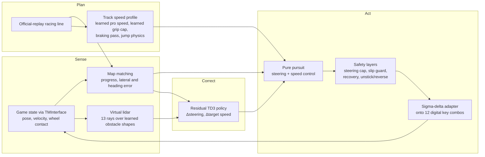

# Linesight hybrid: a self-driving car for TrackMania

A classical robotics stack drives the car. Learned models replace its hand-set numbers, and a
residual reinforcement-learning policy adds small corrections on top. Everything is judged on a
**held-out set of 10 maps** that no part of the system was tuned on.

Built on [Linesight](https://github.com/Linesight-RL/linesight), an open-source RL framework for
TrackMania Nations Forever (see [ATTRIBUTION.md](ATTRIBUTION.md)).

## Headline result

Held-out test set: 10 campaign maps across four difficulty tiers. Each map is driven once, with identical
arguments for every map. The test set was evaluated only five times, each time after a new component was added.

| Version | What it added | Finished | Mean completion | Median time vs pro | Wall hits | Recovery steps |
|---|---|---|---|---|---|---|
| v4 | classical stack | 3/10 | 57.9% | 1.60× | 2 | 529 |
| v5 | + speed model learned from pro replays | 3/10 | 52.3% | 1.63× | 11 | 734 |
| v6 | + grip limit learned from our own logs | 2/10 | 54.0% | 1.50× | 2 | 677 |
| v7 | + measured in-game gravity | 2/10 | 46.2% | 1.44× | 1 | 747 |
| **v8_rl** | **+ residual TD3 policy** | **4/10** | **58.1%** | 1.50× | 1 | **431** |

Base + residual RL is the best result so far. It finished 4 maps against the base stack's 2, lost
none of the base's finishes, and cut recovery steps by 42%. It set the project's best times on A09 (39.56 s)
and B07 (41.82 s). The policy was trained on 6 other maps.

Sources: `eval_results/test_set_v4_baseline.json` … `eval_results/test_set_v8_rl_td3v2.json`.
Per-map tables, the dev and training-map results, and the model validations are in [RESULTS.md](RESULTS.md).

## How the project got here

1. **Pure RL memorised one map.** The Linesight IQN agent, trained from pixels on Hockolicious,
   drove that map in about 54 s. On five other campaign maps (10 runs each), the 3.18M-frame checkpoint finished
   0 of 50 runs. The 10.6M-frame checkpoint finished 8, all of them on A03
   (`eval_results/benchmark_20261014_190540.csv`).
2. **A classical robotics stack generalised.** Map matching, a track speed profile, pure pursuit, and
   recovery behaviours finished 27 of 63 campaign maps, one run each. It had been developed on only 5 of them.
3. **Learned models replaced the hand-set numbers.** Corner speeds came from pro replays, the grip limit
   from our own driving logs, gravity from ghost free fall, and obstacle shapes from pro ghosts.
4. **Residual RL learned the corrections.** A TD3 policy adds bounded steering and target-speed corrections to
   the stack's command. It starts at exactly zero, so training begins from the base stack's behaviour.

## Architecture



The loop runs every 50 ms of game time. Every component and its design decision are explained in [ARCHITECTURE.md](ARCHITECTURE.md).

| Component | Field | What it replaced | Evidence |
|---|---|---|---|
| Map matching on the official-replay line | Robotics (localisation) | the RL agent's recorded lines | `eval_results/hybrid_live/*_official_v3b/` |
| Block map of every campaign map | Robotics (mapping) | nothing (new) | `trackmania_rl/hybrid_block_map.py` |
| Pure pursuit + speed-dependent steering cap | Robotics (control) | the RL agent's driving | `eval_results/test_set_v4_baseline.json` |
| Recovery, unstick/reverse, slip guard | Robotics (safety layers) | nothing (new) | `eval_results/hybrid_live/` |
| Speed model: MLP on 18 track-geometry features | Supervised DL | a hand-written curvature rule | `eval_results/speed_model/validation_v1.json` |
| Grip limit: logistic model of "runs wide" | ML / system identification | a fixed corner speed limit | `eval_results/grip_model/grip_model_v1.json` |
| Gravity measured from pro-ghost free fall | Measurement | a wrong guess (15.4 m/s²) | `eval_results/gravity_measurement.json` |
| Virtual lidar, obstacle shapes learned from ghosts | Learned perception | nothing (new) | `eval_results/range_sensor/validation_v1.json` |
| Residual TD3 policy | Deep RL | nothing (corrections on top) | `eval_results/residual_rl/td3_v2/` |

## Evaluation protocol

- **Fixed split** (`maps/map_split.json`, seed 20261112, drawn once and never re-drawn):
  - **dev**: the 7 maps used for every design choice, plus Hockolicious.
  - **test**: 10 held-out maps.
  - **rl_train**: 6 maps the residual policy trains on.
  - **offline_train**: the 53 non-test official replays, used as offline data.
- **No per-map tuning.** `scripts/run_test_set.py` passes identical arguments to every map.
  `scripts/report_test_set.py` refuses any run that has a per-map speed cap.
- **Metrics.** Finish rate is the headline. Also reported: mean completion, time ratio against the official
  replay (median over finished maps), recovery steps, and contacts (landings, bumps, wall hits, scrapes).
  Contacts are a quality measure, not a failure, because light wall touches and hard landings are normal in the game.
- **Test-set looks:** v4, v5, v6, v7, v8_rl. Each one came only after a substantively new component was added.

## Limitations

- **The sample is small.** 10 maps, one deterministic run each. Single runs flip between finishing and failing
  at knife-edge jumps (a sub-m/s change at takeoff), so the v7 → v8_rl gain is a two-map swing.
  It is consistent with the dev-map result (no lost finishes, small speed-ups), but it is evidence, not proof.
- **Some failures are out of reach for the residual.** B13, C13 and D04 stall in the first 10% in every version,
  and B04, C10 and D07 stall at the same spots in every version. These look like line or geometry problems that
  a ±0.25-steering / ±8 m/s correction can't fix.
- **The car is slow.** Finished maps take about 1.4–1.6× the pro's time. Pros drift through corners at speeds
  this car and controller can't hold.
- **There is no collision telemetry.** Contacts are inferred from speed and trajectory (an "impact" is a speed
  drop of more than 4 m/s in 50 ms).

## Repository layout

```text
trackmania_rl/
  hybrid_live.py            live policy: map matching, safety layers, sigma-delta key adapter, logging
  hybrid_controller.py      PurePursuitController (the live controller)
  hybrid_track_profile.py   speed profile: curvature, braking pass, jump detection
  hybrid_block_map.py       block layout of any campaign map
  speed_features.py, speed_model.py         learned speed model
  grip_model.py                              learned grip limit
  range_sensor.py                            virtual lidar
  residual_observation.py, residual_action.py, residual_reward.py,
  residual_td3.py, residual_training.py      residual RL
  tmi_interaction/          game connection (from Linesight) + unattended launch keys
scripts/
  run_hybrid_controller_live.py   drive one map live
  run_test_set.py, report_test_set.py, make_map_split.py   evaluation protocol
  build_official_centerlines.py   racing lines from the game's official replays
  build_speed_dataset.py, train_speed_model.py, fit_grip_model.py,
  build_range_sensor.py, measure_gravity.py                learned models
  burn_in_residual_critic.py, train_residual.py, retrain_residual_offline.py   RL
eval_results/               every result quoted here (per-step CSV logs, models, reports)
tests/                      pytest suite
```

The original Linesight IQN agent (`trackmania_rl/agents/`, `trackmania_rl/multiprocess/`) is still in the
repo. It provides the pure-RL baseline and the game interface.

## Running it

You need TrackMania Nations Forever, [TMInterface](https://donadigo.com/tminterface), and Python 3.11.
Set up the environment as in [Linesight's installation guide](https://linesight-rl.github.io/linesight/build/html/installation.html),
then `pip install -r requirements_pip.txt`.

The racing lines are built from the game's own official replays, which are not in this repo:

```bash
python scripts/build_official_centerlines.py --install
```

Drive one map with the v7 base stack plus the residual policy:

```bash
python scripts/run_hybrid_controller_live.py --map A02-Race --runs 1 --speed 10 --stuck-cutoff-s 6 --speed-model eval_results/speed_model/speed_model_v1.pt --top-speed 70 --grip-model eval_results/grip_model/grip_model_v1.json --grip-risk 0.2 --range-sensor eval_results/range_sensor/footprints_v1.npz --residual eval_results/residual_rl/td3_v2/final.pt --name A02_demo
```

Reproduce the headline table from the logged runs (no game needed):

```bash
python scripts/report_test_set.py --tag v8_rl
```

Run the tests:

```bash
python -m pytest -q -p no:cacheprovider
```

## Credits

The game interface, process management and the original IQN agent come from
[Linesight](https://github.com/Linesight-RL/linesight). The hybrid stack, the learned models, the residual RL
and the evaluation protocol are this project's work. See [ATTRIBUTION.md](ATTRIBUTION.md).
